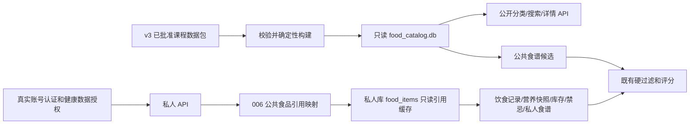

# 公共食物目录与私人业务库

本次扩展基于 `efe2310286de5d9c5699cc8aaba0f3a675067238`，功能分支 `feat/public-food-catalog`。
公共目录可随项目分发；个人数据库不分发。001～004 的文件、SQL、校验和以及原 v2/v3 包均不改写。005 周计划不在本次范围。

## 数据与边界

发布文件：`backend/app/modules/diet/catalog_data/food_catalog.db`，651264 字节。

- 134 种 USDA 食物、12 道中文菜谱、48 条食材依赖、9 个食物分类、4 个食谱分类。
- 文件 SHA256：`4ce321d96ee69fb277b1f7b1fd1fd70b078f5d4f00980d5e3c97811be328782c`。
- 逻辑内容 SHA256：`de5866e95e9476229adffbe2c9c49325a2c753f1110782700388339fb77aa107`。
- 唯一输入：`seed_data/usda_v3_course_demo`；manifest SHA256：`e2d45d1e5e2652ad86769281c330380779ce2738e207c520c68db73e87d11b2b`。
- 审批人署名、时间、用途沿用经过核验的 v3 审批记录，不新增或追溯伪造审批。用途仅限课程演示。
- 食物保留 FDC ID、英文原名、中文名、原始营养数值、来源及来源记录哈希。菜谱保留配料、克重、份数、步骤、团队自编/AI 辅助/未经实际试做声明。
- 投料营养估算不是成品实测；成分及过敏原未经全面安全核验。课程批准不是医学或生产用途批准。
- 公共库没有 profiles、users、diet_records、water_records、库存、目标、Token 或演示用户数据。审批署名是用户明确批准公开的角色署名。
- 原审批记录中的开发机器工作簿绝对路径仅在公共投影中改为文件名，并保留原审批文件 SHA256、工作簿 SHA256；原 v3 文件未变。

## 架构与标识



食物 `food_key` 为 v3 的 `usda:fdc:<FDC ID>`，不借用私人整数 ID。食谱 `recipe_key` 沿用 v3 审批身份；版本保存在独立字段。分类键为种类前缀加中文分类名 SHA256 的前 24 个十六进制字符。

公共库包含 11 张表：`catalog_metadata`、`catalog_food_categories`、`catalog_recipe_categories`、`catalog_sources`、`catalog_foods`、`catalog_food_evidence`、`catalog_recipes`、`catalog_recipe_ingredients`、`catalog_recipe_steps`、`catalog_approvals`、`catalog_package_files`。精确字段及约束见 `build_catalog.DDL`。原始规范化 payload 与可查询的关联表同时保留；营养使用既有 `recipe_service.nutrition` 计算，不增加算法。

公共库通过模块 `__file__` 定位，不依赖工作目录、用户绝对路径或 `HEALTH_DB_PATH`。连接使用 SQLite `mode=ro`、`query_only=ON`，检查版本、文件哈希、逻辑内容、完整性与外键。缺失、损坏、版本不兼容分别返回 503 `CATALOG_MISSING`、`CATALOG_CORRUPT`、`CATALOG_VERSION_UNSUPPORTED`，不在应用导入时检查或迁移，因此不阻塞其他模块导入。

## API

以下路径前缀都是 `/api/diet/catalog`，GET 无需登录或个人档案，且不会访问私人数据库。

| 方法 | 路径 | 作用 |
|---|---|---|
| GET | `/status` | 公共目录版本、来源 manifest、逻辑哈希及范围说明 |
| GET | `/food-categories` | 9 个公共食物分类 |
| GET | `/recipe-categories` | 4 个公共食谱分类 |
| GET | `/foods?q=&category=` | 中文/英文/FDC ID 搜索、稳定分类键过滤 |
| GET | `/foods/{food_key}` | 食物详情和完整来源 |
| GET | `/recipes?q=&category=` | 菜谱搜索、分类过滤、沿用既有营养估算 |
| GET | `/recipes/{recipe_key}` | 配料、步骤、份数及营养详情 |
| POST | `/food-references` | `{"food_key":"usda:fdc:..."}`，返回按需建立的本地引用 |
| POST | `/recipe-copies` | `{"recipe_key":"..."}`，另存为我的食谱 |

公共食物/食谱不存在 PUT、DELETE 或直接创建接口。私人原有接口保留整数 ID、响应及营养口径，食物响应额外提供 `origin`、`editable`、`food_key`。用公共食品时先调用引用接口，之后将返回的本地 `id` 传给原饮食记录、库存、偏好和私人食谱接口。这样既保留真实 SQLite 外键，又避免把字符串公共键误当作私人 ID。

公共食谱复制是用户明确执行的新增私人食谱操作，不修改公共原件；重复点击会创建新的私人副本，不应当作数据导入幂等接口。公共食品引用则按 `(profile_id, food_key)` 幂等。公共食谱推荐只读，不批量建立引用。公共与私人食谱可能同时存在，来源与身份各自明确；用户可归档自己复制的食谱。

## 认证、档案与禁忌

私人饮食接口复用成员 A 的实际 Bearer Token、账号有效性及健康数据授权。管理员可写；获授权且未隐藏敏感资料的查看者只读，包括推荐预览。隐藏敏感资料的查看者不能通过个人饮食数据或推荐结果反推健康禁忌。公共目录与时区配置不要求认证，失效 Token 不影响公开浏览。前端复用现有 profile token，未改公共 client.js。

团队当前是共享单档案 `profile_id=1`，不是每个账号一个档案；没有以 `user.id` 冒充 profile_id，也没有放开未获授权的私人访问。未来多档案改造需要成员 A 提供明确归属契约，本扩展不自行推断。

推荐先过滤明确命中的禁忌再评分。旧食品的明确 USDA 来源 URL 或导入来源身份会扩大相同来源的禁忌排除，不能反过来赋予来源批准或安全核验。公共引用上的库存和喜好可用于原有评分。2026-10-29 按项目新要求调整：没有核对成分和过敏原时保持未知，但不再仅因资料缺失、不完整或过期排除候选；这不是安全认证。明确具体食物、同源食品、食材名称/人工别名及已登记 contains/may_contain 关系命中的禁忌仍排除，不根据子串或未确认的交叉过敏关系猜测。

## 006 扩展迁移

登记表：`diet_extension_schema_migrations`，版本 `006_public_catalog`，不向旧 `diet_schema_migrations` 写入 006。005 不作为前置条件，001～004 必须已完成。

- `diet_catalog_food_links`：本地 food_id 主键及外键、profile_id 外键、稳定 food_key、release_id、record_sha256、created_at；profile+key 唯一。
- `diet_catalog_recipe_origins`：私人 recipe_id 主键及外键、profile_id、原公共 recipe_key/release_id/record_sha256、复制时间。
- 归属触发器校验引用与本地资源属于同一档案；只读触发器阻止修改/删除公共食物缓存或映射。个人库存、偏好与成分核对记录仍可通过原权限接口维护。
- BEGIN IMMEDIATE 串行写入，校验已发布 004、登记校验和、完整 DDL 和外键。幂等执行返回无变更；任意失败整体回滚，不重建历史表。
- 创建链接时才写入营养参考缓存；只读浏览和推荐不写入缓存。已有健康记录、库存、目标、偏好和食物记录不被自动转换或覆盖。
- 公共数据更新造成 record_sha256 不同则拒绝自动替换缓存并返回 409 `CATALOG_REFERENCE_STALE`；历史营养快照继续保存原值。将来的版本升级必须另行设计并获批。
- 未完成 006 时公共浏览可用，创建引用返回迁移提示；推荐明确提示仅使用私人食谱。

普通 FastAPI 启动不执行 001～004 或 006。`DIET_APPLY_MIGRATIONS` 不是自动升级开关。已有正式库迁移须另外授权、备份并在副本验证；本次开发没有操作正式库。

## 新克隆项目与临时验收

克隆时必须带上 `catalog_data/food_catalog.db`、`catalog-release.json`、`SHA256SUMS.txt`。无需运行数据导入命令，即可调用公共 GET API 或打开饮食页面的默认公共食品/食谱页。基础环境仍按项目锁定依赖安装，不能复制别人的虚拟环境。

此前运动模块缺失文件现已在 main `dcb9c4b` 补齐。真实五模块复核见 `PUBLIC-CATALOG-FULL-ACCEPTANCE.md`。以下命令仍可用于独立饮食验收，不代表真实五模块应用启动。

在项目根目录开启后端终端：

```powershell
Set-Location backend
& ..\.venv\Scripts\python.exe -B -m app.modules.diet.catalog_preview --port 8018
```

该工具仅创建新的 TemporaryDirectory 数据库，显式基础初始化及 001～004、006，不接收现有数据库路径；退出时清理临时库。页面保留开发演示、非真实用户/非真实健康记录标记。初始没有账号或档案；需要私人功能时通过真实注册、登录、健康数据授权及档案 API 建立明确标注的临时测试档案。

另一个终端启动原前端：

```powershell
Set-Location frontend
$env:API_PROXY_TARGET = 'http://127.0.0.1:8018'
$env:FRONTEND_PORT = '5188'
$env:VITE_API_BASE_URL = ''
npm run dev
```

访问 `http://127.0.0.1:5188/diet`。完整验收使用真实 main、同一临时 HEALTH_DB_PATH 与显式迁移，入口为 `backend/tests/run_diet_full.py`。

006 CLI 默认只读检查已存在的数据库；仅对已获批准的临时库执行 `--apply`：

```powershell
# backend 目录。$TestDb 必须来自本次创建的独立临时库，不使用默认 health.db。
& ..\.venv\Scripts\python.exe -B -m app.modules.diet.migration_006 --database $TestDb
& ..\.venv\Scripts\python.exe -B -m app.modules.diet.migration_006 --database $TestDb --apply
```

## 构建与发布

`python -B -m app.modules.diet.build_catalog --output <全新输出目录>/food_catalog.db` 先核验 v3 所有清单 SHA256、审批记录及 48 条依赖，再按确定顺序建库。拒绝覆盖已有数据库及发布侧文件；不打开健康库。当前发布生成环境为 Python 3.12、SQLite 3.45.3。相同输入和 SQLite 版本生成相同文件哈希；其他 SQLite 版本仍须校验逻辑哈希，不能静默替换本次已审核文件哈希。

`.gitignore` 只增加精确例外 `!/backend/app/modules/diet/catalog_data/food_catalog.db`。其他 .db、SQLite sidecar、备份、虚拟环境、密钥和健康资料继续忽略。目录自身 `.gitattributes` 固定发布 JSON/清单 LF，并将公共 .db 标记为 binary。Windows 包和 Web 部署均需要原样打包此目录，建议部署权限设为只读。

USDA 数据来源及已有许可说明见 `../seed_data/usda_v3_course_demo/LICENSE-SOURCES.md`：FoodData Central 数据为 CC0；署名 U.S. Department of Agriculture, Agricultural Research Service. FoodData Central。团队中文整理、菜谱及程序不因此自动成为 CC0；本实现不替团队扩大许可证。

## 验收与回退

运行命令、通过数量和阻塞清单见 `PUBLIC-CATALOG-ACCEPTANCE.md`。专项覆盖重复构建、完整来源、匿名浏览、权限拒绝、公共只读保护、引用幂等、旧源禁忌、营养快照、库存、私人复制、006 回滚及版本错误；前端检查桌面与 390/320px 布局。

回退应用代码不应回退/删除私人数据库。006 是独立追加表；原有整数 food_id 引用和快照保留。不得删除已被饮食记录/库存/私人食谱引用的缓存或强行删除映射。旧版本客户端不能识别公共只读标记，旧写接口遇到数据库保护触发器会拒绝写入，因此如需回退，应先停用相关写入口并在副本核验，不承诺向旧未鉴权版本无缝降级。公共库缺失/损坏时恢复相同版本三个发布文件，不新建空公共库掩盖故障。
